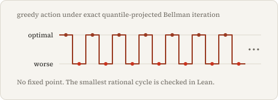
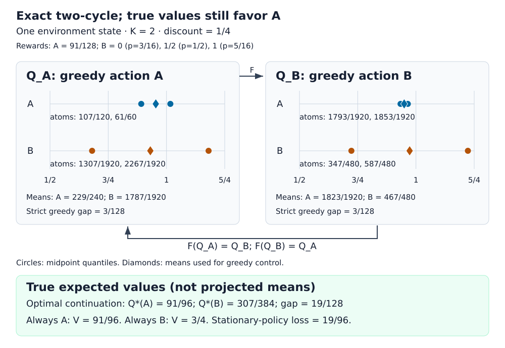

# Quantile Cycles

A one-state MDP in which exact quantile Bellman control never converges. The greedy action alternates between the best action and a worse one forever, and the critic tables alternate with it. The smallest case, two quantiles per action, is proved in Lean:

```lean
theorem strict_suboptimal_two_cycle :
    F Q_A = Q_B ∧ F Q_B = Q_A ∧ Q_A ≠ Q_B ∧
    greedy Q_A = .A ∧ greedy Q_B = .B ∧
    trueBackup (greedy Q_B) V_A < trueBackup .A V_A
```

`F` is the exact Bellman operator with hard midpoint-quantile projection, picking the next action by the mean of the critic's atoms. Sampled learning with the Huber loss mostly avoids the cycle (see below).

<picture><source media="(prefers-color-scheme: dark)" srcset="docs/hero-dark.svg"></picture>

## The smallest example

One state, two actions, both return to the same state. Discount 1/4, K = 2 quantiles per action.

| Action | Reward | True mean |
| --- | --- | ---: |
| A | 91/128 always | 91/128 |
| B | 0, 1/2, 1 with probability 3/16, 1/2, 5/16 | 9/16 |

A is better by 19/128. Run the exact quantile Bellman update, choosing the next action by the mean of each critic's two atoms, and the two critic tables below map to each other, so the update has no fixed point. One table picks A and the other picks B, each by a margin of 3/128. Always playing B would lose 19/96 in discounted value.



[`lean/QuantileCycles.lean`](lean/QuantileCycles.lean) defines the reward laws, `F` and the two tables (Lean 4.19, Mathlib). Around the theorem it also proves that the reward laws are valid, that A is strictly optimal over all randomized policies, and that every quantile is the generalized inverse rather than a lookup. Only Lean's standard axioms are used ([`results/lean-axioms.txt`](results/lean-axioms.txt)), and CI rebuilds it on every push.

## Every K

[`THEOREM.md`](THEOREM.md) generalizes the example on paper, not in Lean:

- For every K ≥ 2 and discount β ≤ 1/(2K), a one-state MDP with rewards in [0,1] has a strict two-cycle. Every finite starting table converges to it up to phase, whatever the tie-breaking.
- For a fixed discount γ, a delay chain of ⌈log(2K)/−log γ⌉ states gives an exact cycle of twice that length. The checked periods at γ = 0.9 run from 28 to 80.
- K = 1 is the boundary: the one-atom operator is a γ-contraction and cannot cycle.

`python -B verify.py` re-checks all of this in exact rational arithmetic for K = 2 to 16, 32, 64 and 128, including zero-initialized starts. It needs only the standard library.

## Sampled learning

The cycle belongs to the exact operator with its hard projection. To see what learning from samples does, I ran tabular quantile learning on the same MDPs (32 seeds, 100,000 updates, constant step size). Share of the last 20,000 greedy choices that went to the worse action B:

| K (MDP changes with K) | Pinball loss | Huber loss | Scalar Q-learning |
| ---: | ---: | ---: | ---: |
| 2 | 38% | 0% | 0% |
| 8 | 7.9% | 0% | 0% |
| 32 | 10% | 0.4% | 7.8% |

Plain quantile regression (pinball loss) keeps choosing B. Quantile-Huber, the loss people actually train with, almost never does, and at K = 32 it picks B less often than scalar Q-learning on the same samples. With the K = 2 MDP fixed and a bigger critic (8 or 32 atoms), every loss reaches zero regret. This is a tabular sampler with no replay buffer or network. Decaying step sizes, population-gradient versions and intervals are in [docs/sampled-study.md](docs/sampled-study.md).

## Run it

```sh
python -B verify.py                                        # exact certificates, about 15 s
python -B -m unittest discover -s tests -p test_exact.py   # checker tests
cd lean && lake exe cache get Mathlib.Data.Rat.Defs Mathlib.Tactic.NormNum Mathlib.Tactic.Linarith && lake build
```

The sampled results re-check without retraining: `pip install -r requirements-sampled.txt && python -B tools/summarize_sampled.py --check`.

## Prior work

Rowland et al. showed quantile critics can prefer a worse action once ([ICML 2019](https://proceedings.mlr.press/v97/rowland19a.html)). Bellemare, Dabney and Munos found exact distributional control can cycle, but through tie-breaking between equal-mean actions ([ICML 2017](https://proceedings.mlr.press/v70/bellemare17a.html)). Here every greedy choice is strict and the cycle is recurrent and attracting. More in [docs/prior-work.md](docs/prior-work.md). Quantile projection and Huber loss: [Dabney et al.](https://arxiv.org/abs/1710.10044).

MIT license.
